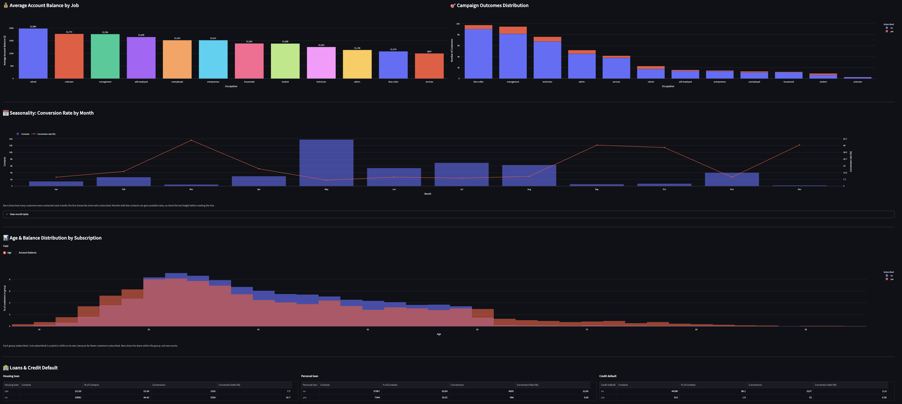
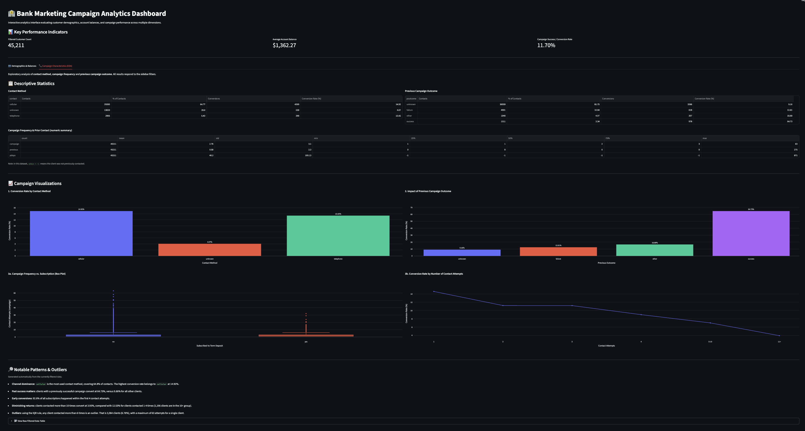
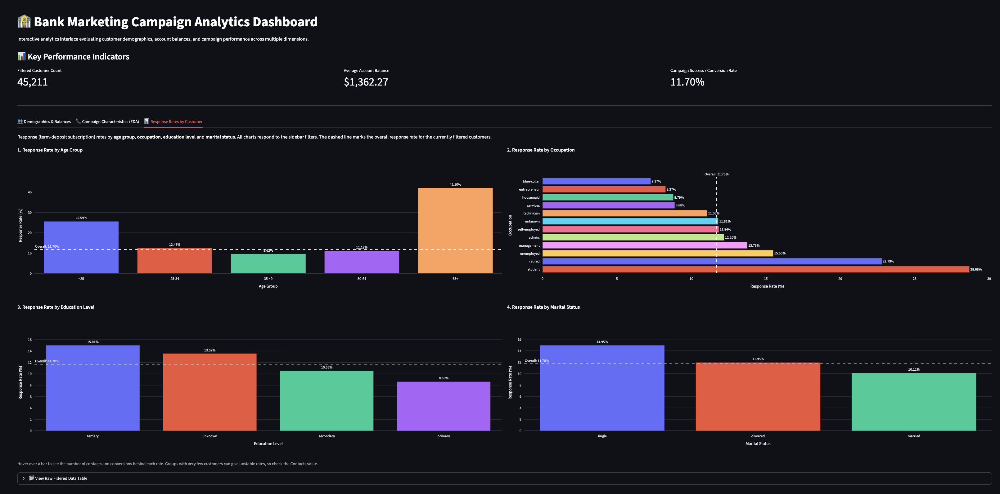
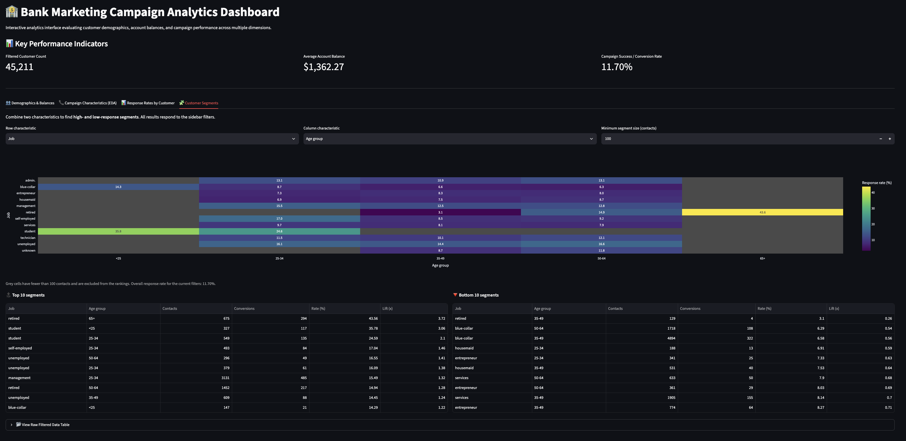

# Bank Marketing Campaign: Findings and Methodology Report

This report explains what the Bank Marketing Campaign Analytics Dashboard shows and how the numbers were produced. You do not need to open the code to read it. Every figure below is for the **full dataset with no dashboard filters applied**, so you can reproduce it by opening the dashboard and leaving all five filters on "All".

---

## 1. Summary

1. **Past success is the strongest signal:** clients who said yes in an earlier campaign subscribe 64.73% of the time, against 11.70% overall.
2. **Cellular beats the alternatives:** cellular contacts convert at 14.92%, while contacts with an unknown channel convert at only 4.07%.
3. **Early attempts pay off, later ones do not:** conversion falls from 14.60% at one attempt to 3.93% at 11 or more, and 92.6% of subscriptions happen within four attempts.
4. **Some customer groups respond far more than others:** clients aged 65+ (42.10%), students (28.68%) and retirees (22.79%) respond best, and blue-collar workers (7.27%) respond least.
5. **Timing and existing loans matter:** May carries 30.4% of all contacts but converts at only 6.72%, and customers with a housing loan convert at 7.70% against 16.70% for those without.

---

## 2. Dataset

| Item | Detail |
|---|---|
| Name | UCI Bank Marketing dataset |
| Source | [archive.ics.uci.edu/dataset/222/bank+marketing](https://archive.ics.uci.edu/dataset/222/bank+marketing) |
| Content | Phone marketing campaigns of a Portuguese bank, selling a term deposit |
| Size | 45,211 customers (one row per customer contacted), 17 fields |
| Outcome | Whether the customer subscribed to a term deposit (yes or no) |
| Personal data | None. The file has no names, account numbers, phone numbers or other identifiers. It holds only general attributes such as age, job and account balance. |

The 17 fields cover customer details (age, job, marital status, education, credit default, account balance, housing loan, personal loan), campaign details (contact method, day and month of contact, call duration, number of contacts in this campaign, days since a previous campaign, number of earlier contacts, previous campaign outcome) and the outcome itself.

---

## 3. Data preparation

All preparation is done by `data_prep.py`. The dashboard calls it when it starts, so everyone sees exactly the same prepared table, and anyone can reproduce it from the raw file. It runs three steps in order:

1. **Load:** read the raw file (`data/train.csv`) exactly as it is on disk. The file uses semicolons to separate columns.
2. **Clean:** produce a cleaned copy and leave the raw data untouched.
   - Text values are trimmed of extra spaces and put in lowercase, so the same category is never spelled two ways. The label "unknown" is kept as it is.
   - Number fields (age, balance, day, call duration, contact counts, days since last contact) are converted to numbers.
   - Months are put in calendar order (January to December).
   - Three helper columns are added: the **age group** (<25, 25-34, 35-49, 50-64, 65+), a **converted** flag (1 if the customer subscribed, 0 if not), and a **previously contacted** flag (yes if the customer was contacted in an earlier campaign, no if not).
3. **Validate:** stop with a clear error if the data is not what the dashboard expects: a missing column, an empty value, an outcome other than yes or no, or a row count other than 45,211. This prevents the dashboard from silently showing wrong numbers.

### Three decisions

| Decision | What we did | Why |
|---|---|---|
| **"Unknown" is kept** | Fields such as contact method, previous outcome, job and education contain the label "unknown". We kept it as its own category instead of deleting those rows or guessing a value. No rows are removed during preparation. | Deleting rows would remove a large share of customers (28.8% of contacts have an unknown contact method) and change the totals. "Unknown" also behaves differently from the known categories, which is itself a finding. |
| **`pdays = -1` is kept, and `previously_contacted` is added** | In the raw data, `pdays` is the number of days since the customer was last contacted, and -1 means "never contacted before". We left the raw value as it is and added a simple yes/no column, `previously_contacted` ("no" when `pdays` is -1, otherwise "yes"). | Treating -1 as a real number of days would distort averages. The new column makes the meaning clear without changing the original data. |
| **No cleaned CSV is committed** | The repository holds only the raw file. Cleaning runs in code each time the dashboard loads. | One source of truth: nobody can edit or use an outdated cleaned copy by mistake, and anyone can trace every number back to the raw file. |

### How the automated tests check the numbers

The project includes 27 automated tests. They work by recalculating the numbers separately from the dashboard, directly from the raw file, and comparing the two. They check that:

- **The data preparation behaves as described (15 tests).** The prepared table has 45,211 customers and the expected columns; the raw data is never modified; "unknown" is kept; `pdays` is unchanged; the previously contacted and converted flags agree with the raw values; months are in calendar order; age groups split at the right ages; and the validation step stops with a clear error when a column is missing, a value is empty, the outcome is not yes or no, the row count is wrong, or a number cannot be read.
- **The headline numbers are right (7 tests).** Total customers (45,211), overall conversion rate (11.70%) and average balance ($1,362.27); one filtered view (telephone contacts with a previous success: 114 customers, 65.79%); and three customer segments (retired 65+, student under 25 and blue-collar 35-49).
- **The month figures are right (5 tests).** Months appear in calendar order; the monthly contacts and subscriptions add up to the full dataset; each month's contacts, subscriptions and conversion rate match a separate calculation, including when filters are applied; and a month with no contacts shows zero rather than an error.

If a code change ever alters one of these numbers, the tests fail, so the problem is caught before the change is merged.

---

## 4. KPI definitions

| KPI | Plain meaning | Formula |
|---|---|---|
| **Conversion rate** | Share of contacted customers who subscribed to a term deposit. In this dataset "response" and "conversion" mean the same thing. | Customers with outcome "yes" ÷ total customers contacted × 100 |
| **Channel conversion** | Conversion rate for one contact method (cellular, telephone, unknown). | Subscribed customers reached by the channel ÷ total customers reached by the channel × 100 |
| **Segment conversion** | Conversion rate for one customer group, or for a combination of two (for example, retired customers aged 65+). | Subscribed customers in the segment ÷ total customers in the segment × 100 |
| **Lift** | How many times better (or worse) a segment performs than the overall rate. A lift of 1.00 means average; above 1.00 means better than average. | Segment conversion rate ÷ overall conversion rate |

Worked example: retired customers aged 65+ convert at 43.56%. The overall rate is 11.70%, so the lift is 43.56 ÷ 11.70 = **3.72x**.

When you use the dashboard filters, the overall rate used for lift (and for the dashed reference lines on charts) is the rate for the filtered customers, not for the full dataset.

---

## 5. Key findings

Each finding gives its number and the dashboard tab where you can see it. Tab names match the dashboard exactly.

### 5.1 Past success is the strongest signal

- **64.73%** conversion for customers whose previous campaign succeeded, compared with **11.70%** overall.
- Customers with a previous success are only 3.34% of contacts (1,511 customers), so this is a small but very valuable group.
- **Where to see it:** *Campaign Characteristics (EDA)* tab, "Impact of Previous Campaign Outcome" chart.

### 5.2 Channel: cellular works best, unknown works worst

- Cellular **14.92%**, telephone **13.42%**, unknown **4.07%**.
- Cellular is the main channel (64.77% of contacts). Telephone is similar in performance but used for only 6.43% of contacts. Unknown is 28.80% of contacts.
- **Where to see it:** *Campaign Characteristics (EDA)* tab, "Conversion Rate by Contact Method" chart.

### 5.3 Contact attempts: diminishing returns

| Attempts | 1 | 2 | 3 | 4 | 5–10 | 11+ |
|---|---:|---:|---:|---:|---:|---:|
| Conversion rate | 14.60% | 11.20% | 11.19% | 9.00% | 7.01% | 3.93% |

- **92.6%** of all subscriptions happened within the first 4 attempts.
- **Where to see it:** *Campaign Characteristics (EDA)* tab, "Conversion Rate by Number of Contact Attempts" chart (same buckets).

### 5.4 Customers: who responds most and least

- Highest: age **65+ at 42.10%**, **students at 28.68%**, **retirees at 22.79%**.
- Lowest: **blue-collar workers at 7.27%**.
- Overall rate for comparison: 11.70%.
- **Where to see it:** *Response Rates by Customer* tab (age group and occupation charts).
- **Caution:** the 65+ group has only 810 customers and students 938, so these rates are less stable than those of larger groups.

### 5.5 Segments: combining two characteristics

- **Retired customers aged 65+: 43.56%** (3.72x lift, 675 customers).
- **Students under 25: 35.78%** (3.06x lift, 327 customers).
- These come from the Job × Age group view with the minimum segment size at its default of 100 contacts.
- **Where to see it:** *Customer Segments* tab (heatmap and Top 10 table).

### 5.6 Seasonality: the busiest month is one of the weakest

- **March, September, October and December convert at 44–52%**, but together they account for only about 4.4% of contacts (December alone has 214 contacts).
- **May converts at 6.72% but receives 30.4% of all contacts** (13,766 of 45,211, the figure shown in the dashboard's month table).
- **Where to see it:** *Demographics & Balances* tab, "Seasonality: Conversion Rate by Month" chart (bars show contacts, the line shows conversion rate; a month table is available below it).
- **Caution:** the high-rate months rest on few contacts, so treat them as a prompt for testing rather than a proven opportunity.

### 5.7 Loans: customers without loans respond more

| Loan type | Has the loan | Does not have the loan |
|---|---:|---:|
| Housing loan | 7.70% | 16.70% |
| Personal loan | 6.68% | 12.66% |

- **Where to see it:** *Demographics & Balances* tab, "Loans & Credit Default" section (Housing loan and Personal loan tables).

---

## 6. Limitations

- **Association, not cause.** The dashboard shows which groups convert more, not why. For example, a high rate after a previous success does not prove the earlier campaign caused it.
- **Small groups.** Some of the strongest results come from small groups: customers aged 65+ (810), students (938), the high-rate months (214 to 738 contacts each) and customers with a credit default (815 customers, 6.38% conversion against 11.80% without). Rates for small groups can swing widely.
- **"Unknown" categories.** "Unknown" is large for contact method (28.80% of contacts) and previous outcome (81.75%). It may hide a mix of different channels or histories, so comparisons involving it should be read with care.
- **Months pooled across years.** The data covers several years, but the month analysis combines the same month from every year. A difference between months could partly reflect different years, economic conditions or campaign styles.
- **Minimum segment size is a choice.** The Customer Segments tab hides segments below a chosen number of contacts (default 100). A different threshold changes which segments appear in the rankings.
- **Historical data.** The data comes from past campaigns of one Portuguese bank, and results may not carry over to other banks, markets or periods.

---

## 7. How to use the dashboard

The dashboard opens in a web browser and is run by the project team; setup steps for the team are in the project README.

### The five filters (left sidebar)

Use the sidebar to narrow every chart and table at once. Leave a filter on "All" to include everyone.

| Filter | What it does |
|---|---|
| Occupation / Job | Show one occupation only |
| Age Group | Show one age band: <25, 25-34, 35-49, 50-64, 65+ |
| Education Level | Show one education level |
| Contact Method | Show cellular, telephone or unknown contacts |
| Previous Outcome | Show customers by the result of the earlier campaign |

The three summary cards at the top (customer count, average balance, conversion rate) update with the filters.

### The four tabs

| Tab | Question it answers |
|---|---|
| **Demographics & Balances** | What do our customers look like (balances, ages, loans), and how does conversion change by month? |
| **Campaign Characteristics (EDA)** | How do contact method, number of attempts and earlier campaign results relate to subscriptions? |
| **Response Rates by Customer** | Which age groups, occupations, education levels and marital statuses respond most? |
| **Customer Segments** | Which combinations of two characteristics respond best or worst? |

#### Demographics & Balances

#### Campaign Characteristics (EDA)

#### Response Rates by Customer

#### Customer Segments

### Tips

- Hover over any bar or point to see the number of contacts and conversions behind a rate.
- Check the contact count before trusting a high rate. Small groups can be misleading.
- Expand "View Raw Filtered Data Table" at the bottom of the page to see the underlying rows.
