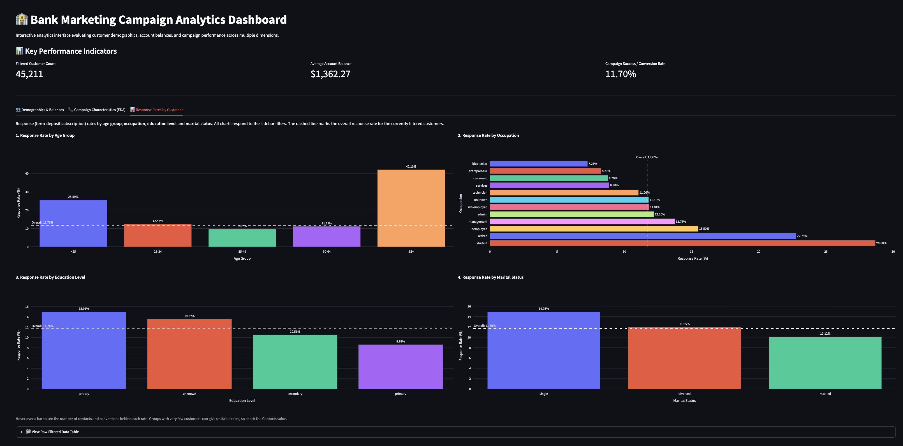

# Task Summary: Response Rate Visualizations by Customer Characteristics

**Project:** Banking Marketing Campaign Analytics Dashboard
**Deliverable:** New **📊 Response Rates by Customer** tab in `app.py`
**Dataset:** UCI Bank Marketing dataset (`data/train.csv`), 45,211 customers

## 1. Objective

Build interactive visualizations that show response rates (term-deposit subscriptions) broken down by customer characteristics, and make sure they respond to the sidebar filters.

## 2. Acceptance Criteria

| Criterion | Status | Where |
|---|---|---|
| At least 3 visualizations of response rates by customer characteristics | ✅ Done (4 charts) | Age group, occupation, education level, marital status |
| Visualizations are clear, accurate and interactive | ✅ Done | Plotly bar charts with value labels, hover details (contacts, conversions) and a dashed reference line for the overall rate. Chart values were checked against a separate calculation from the raw data. |
| Visualizations reflect applied filters | ✅ Done | All charts use the same filtered data as the rest of the dashboard, so the five sidebar filters apply. An empty filter result shows a warning instead of an error. |

The existing **Demographics & Balances** and **Campaign Characteristics (EDA)** tabs are unchanged.

## 3. What Was Added

- A reusable function, `plot_response_rate`, that builds a response-rate bar chart for any column and marks the overall rate with a dashed line.
- A third tab with four charts in a two-column layout. Age groups keep their natural order. Occupation, education and marital status are sorted by response rate.
- A short caption reminding users to check the number of contacts behind each rate.

## 4. Results (full dataset, no filters)

Overall response rate: **11.70%**.

### Age Group

| Age Group | Contacts | Conversions | Response Rate |
|---|---:|---:|---:|
| 65+ | 810 | 341 | 42.10% |
| <25 | 809 | 207 | 25.59% |
| 25-34 | 14,204 | 1,773 | 12.48% |
| 50-64 | 9,384 | 1,044 | 11.13% |
| 35-49 | 20,004 | 1,924 | 9.62% |

### Occupation

| Occupation | Contacts | Conversions | Response Rate |
|---|---:|---:|---:|
| student | 938 | 269 | 28.68% |
| retired | 2,264 | 516 | 22.79% |
| unemployed | 1,303 | 202 | 15.50% |
| management | 9,458 | 1,301 | 13.76% |
| admin. | 5,171 | 631 | 12.20% |
| self-employed | 1,579 | 187 | 11.84% |
| unknown | 288 | 34 | 11.81% |
| technician | 7,597 | 840 | 11.06% |
| services | 4,154 | 369 | 8.88% |
| housemaid | 1,240 | 109 | 8.79% |
| entrepreneur | 1,487 | 123 | 8.27% |
| blue-collar | 9,732 | 708 | 7.27% |

### Education Level

| Education | Contacts | Conversions | Response Rate |
|---|---:|---:|---:|
| tertiary | 13,301 | 1,996 | 15.01% |
| unknown | 1,857 | 252 | 13.57% |
| secondary | 23,202 | 2,450 | 10.56% |
| primary | 6,851 | 591 | 8.63% |

### Marital Status

| Marital Status | Contacts | Conversions | Response Rate |
|---|---:|---:|---:|
| single | 12,790 | 1,912 | 14.95% |
| divorced | 5,207 | 622 | 11.95% |
| married | 27,214 | 2,755 | 10.12% |

## 5. Key Findings

- **Age shows the widest spread.** Customers aged 65+ respond at 42.10% and customers under 25 at 25.59%, compared with 9.62% for ages 35-49. The 35-49 group is also the largest, with 20,004 contacts.
- **Students and retirees respond most.** Students respond at 28.68% and retirees at 22.79%, while blue-collar workers respond at 7.27%.
- **Education has a moderate effect.** Tertiary-educated customers respond at 15.01%, against 8.63% for primary education.
- **Single customers respond more than married ones.** The rates are 14.95% and 10.12%.

## 6. Notes & Limitations

- These are descriptive patterns, not proof of cause. For example, a high rate among retirees shows association, not that being retired causes subscriptions.
- The highest-response age groups (65+ and under 25) each have only about 800 customers, so their rates are less stable than those of the large groups. The same applies when filters narrow the data. The hover text shows the contacts behind each rate.
- The `unknown` education and occupation categories are small and may hide a mix of customers.
- Age-group boundaries come from the existing binning in `app.py`.

## 7. Next Steps (Suggested)

- Check whether these patterns hold after controlling for other characteristics, such as age within occupation.
- Add segmentation views that combine characteristics (for example, age group by occupation) to find high-response segments.